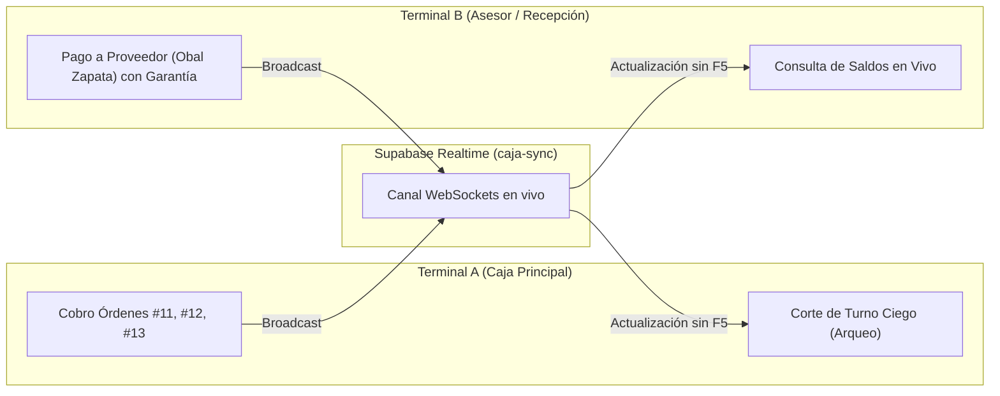

# Guión Maestro de Pruebas Funcionales: Punto de Venta (POS), Cortes de Caja y Reportes Contables

> **Sistema:** Cova (Plataforma Operativa de Taller Automotriz)  
> **Empresa Activa:** Cova (`b2ad09db-0a34-4876-9ca3-d584c40bd294`)  
> **Sucursal Activa:** Cova Matriz Culiacán (`b2ad09db-0a34-4876-9ca3-d584c40bd295`)  
> **Módulo:** `/caja` (Punto de Venta, Arqueos, Caja Chica y Auditoría)  
> **Objetivo:** Ejecutar la batería de pruebas de aceptación técnica y funcional de extremo a extremo, validando la estabilidad operativa individual, la sincronización concurrente multi-terminal en tiempo real y la precisión de los reportes.

---

## 1. Ficha Técnica y Entorno de Prueba

### 1.1 Configuración de Doble Terminal (Simulación Multi-Caja)
Para simular el flujo real del taller (donde el recepcionista y el cajero pueden tener la pantalla abierta simultáneamente):

* **Terminal A (Caja Principal / Mostrador):**
  - **Navegador:** Tu navegador habitual (ej. Google Chrome).
  - **Usuario:** `eduardo@cova.mx`
  - **Contraseña:** `Cova2026!`
  - **Rol:** *SuperAdmin*

* **Terminal B (Asesor de Servicio / Recepción):**
  - **Navegador:** Ventana de incógnito o segundo navegador (ej. Microsoft Edge).
  - **Usuario:** `larissa.orozcor@gmail.com` *(o puedes usar el mismo `eduardo@cova.mx`)*
  - **Contraseña:** `Cova2026!`
  - **Rol:** *Administrador*

- **Distribución en pantalla:** Colocar ambas ventanas en paralelo (pantalla dividida 50/50).

---

## 2. Matriz de Datos Reales en Base de Datos

Las órdenes de trabajo y proveedores ya se encuentran sembrados en la base de datos de Cova con los siguientes datos exactos:

### 2.1 Órdenes Pendientes de Cobro (Punto de Venta)
| Folio | Cliente | Vehículo y Placas | Servicios y Refacciones | Total / Saldo | Caso Asignado |
| :---: | :--- | :--- | :--- | :---: | :--- |
| **#11** | Carlos Mendoza `667-281-9921` | **Nissan Versa Advance 2021** Placas: `VNP-281-A` | • M.O. Balatas: `$450.00` • Balatas Cerámicas: `$750.00` | **`$1,200.00`** | **Caso 2.1:** Efectivo Total con cálculo de cambio |
| **#12** | Andrea Villarreal `667-883-1049` | **Honda Civic Touring 2020** Placas: `VSD-992-B` | • Montaje y calibración: `$300.00` • Llanta Michelin 205/55 R16: `$2,150.00` | **`$2,450.00`** | **Caso 2.2:** Terminal TPV / Tarjeta |
| **#13** | Minera del Fuerte S.A. `667-715-4400` | **Toyota Hilux Dbl Cab 2022** Placas: `VLG-401-C` | • Alineación 3D + Amortiguador: `$1,150.00` • Par Amortiguadores Gas: `$1,850.00` | **`$3,000.00`** | **Caso 2.3:** Split Payment (Efectivo + SPEI) |

### 2.2 Cuentas Bancarias y Proveedores de Cova
* **Proveedores de Refacciones con Garantía:** *Obal Zapata*, *Dar Refaccionaria*, *AutoZone*, *Ryuk*.
* **Proveedores de Neumáticos:** *Tersa*, *Ayon*, *Herrera*, *Llyasa*.
* **Cuentas Bancarias Fiscales/Operativas:** *BanBajío Fiscal*, *Inbursa Operativa*.

---

## 3. Matriz Matemática del Corte de Caja (Cero Descuadre)

Para que al finalizar el turno el sistema demuestre control contable absoluto con **`$0.00` de descuadre**, la matemática del flujo es la siguiente:

$$\begin{aligned}
\text{Fondo 1 Inicial (Operativo en Gaveta)} &= \$400.00 \\
\text{Fondo 2 Inicial (Reserva / Morlacos)} &= \$8,500.00 \\
\text{(+) Cobro Orden \#11 en Efectivo} &= +\$1,200.00 \\
\text{(+) Cobro Orden \#13 (Fracción Efectivo en Split)} &= +\$1,000.00 \\
\text{(-) Egreso Gasto Operativo Menor} &= -\$250.00 \\
\text{(-) Egreso Pago a Proveedor Obal Zapata (Amortiguador)} &= -\$850.00 \\
\hline
\mathbf{\text{Saldo Físico Teórico Esperado en Fondo 1}} &= \mathbf{\$1,500.00} \\
\mathbf{\text{Saldo Declarado por Cajero en Arqueo Ciego}} &= \mathbf{\$1,500.00} \\
\mathbf{\text{Diferencia Final}} &= \mathbf{\$0.00 \quad \text{(Cuadrado Exacto)}} \\
\hline
\text{Fondo Dejado para Siguiente Turno} &= \$400.00 \\
\text{Remesa Retirada a Caja Fuerte / Dueño} &= \$1,100.00
\end{aligned}$$

* **Cobros Bancarios que NO tocan la gaveta física:**
  - Orden #12 (Tarjeta / TPV): `$2,450.00` (Terminal Point Smart)
  - Orden #13 (Fracción SPEI en Split): `$2,000.00` (Cuenta BanBajío)

---

## 4. Bloque 1: Apertura de Turno y Control de Fondos Iniciales

| ID | Acción | Datos a Ingresar | Resultado Esperado | Criterio de Aceptación |
| :--- | :--- | :--- | :--- | :--- |
| **TC-1.1** | Ingresar a `/caja` en **Terminal A**. | — | La barra superior (`TurnoStatusBar`) muestra la alerta *"Sin Turno Abierto"* y el botón **[ Abrir Turno ]**. | Bloquea la operación de cobro hasta que un cajero se responsabilice del turno. |
| **TC-1.2** | Clic en **[ Abrir Turno ]** en Terminal A. | Despliegue del modal `AbrirTurnoModal`. | Carga automáticamente los campos de Fondo 1 y Fondo 2. | Sugiere montos estándar preconfigurados. |
| **TC-1.3** | Confirmar apertura de turno. | • **Fondo 1 (Operativo):** `$400.00` • **Fondo 2 (Reserva):** `$8,500.00` Clic en **[ Confirmar Apertura ]**. | El modal se cierra. La barra superior cambia a **Turno Abierto**, mostrando el cajero, hora de inicio y saldo disponible en verde: `$400.00`. | Registra el turno en base de datos. |
| **TC-1.4** | **Verificación en Terminal B (Concurrencia).** | Mirar la pantalla de Terminal B sin oprimir F5. | En menos de 1 segundo, la barra de Terminal B se sincroniza vía WebSocket mostrando **Turno Abierto**. | Notificación en tiempo real sin requerir recargar página. |

---

## 5. Bloque 2: Punto de Venta (POS) — Cobros de Mostrador

### Caso 2.1: Cobro Total en Efectivo (con Cálculo de Cambio)
| ID | Acción | Datos a Ingresar | Resultado Esperado | Criterio de Aceptación |
| :--- | :--- | :--- | :--- | :--- |
| **TC-2.1** | En **Terminal A**, seleccionar en la lista la **Orden #11** (Carlos Mendoza - Versa `VNP-281-A`). | Saldo pendiente: **`$1,200.00`**. | Se cargan los datos del auto, el cliente y el saldo en el panel central de cobro. | Identificación visual rápida por folio o placas. |
| **TC-2.2** | Seleccionar método **Efectivo**. | Importe: `$1,200.00`. | Se activa la calculadora de cambio y los botones de denominación rápida. | El importe queda prellenado al saldo exacto. |
| **TC-2.3** | Simular que el cliente paga con `$1,500.00`. | Clic en botones rápidos: `$1,000` + `$500` (o escribir `1500` en "Efectivo Recibido"). | El sistema calcula en tiempo real un cambio de **`$300.00`** en color verde. | Elimina errores de cálculo mental en ventanilla. |
| **TC-2.4** | Clic en **[ Cobrar e Imprimir Ticket ]**. | — | 1. Se registra el cobro en BD. 2. Se abre `ReceiptModal` con formato de ticket térmico. 3. El saldo de la Orden #11 pasa a `$0.00` (Liquidada). | Ticket listo con datos del taller, desglose de balatas y desglose de cambio entregado. |
| **TC-2.5** | **Verificación en Terminal B (Concurrencia).** | Observar Orden #11 en Terminal B sin refrescar. | La orden cambia automáticamente a etiqueta verde **"Pagado"** y su saldo a `$0.00`. Si se intenta cobrar, el botón está bloqueado. | **Protección anti doble cobro** entre mostradores. |

---

### Caso 2.2: Cobro con Tarjeta / Terminal TPV
| ID | Acción | Datos a Ingresar | Resultado Esperado | Criterio de Aceptación |
| :--- | :--- | :--- | :--- | :--- |
| **TC-2.6** | En **Terminal A**, seleccionar la **Orden #12** (Andrea Villarreal - Civic `VSD-992-B`). | Saldo pendiente: **`$2,450.00`**. | Se despliega la orden con la llanta Michelin. | Correcta visualización de totales. |
| **TC-2.7** | Seleccionar la pestaña de método **TPV / Tarjeta**. | • **Terminal:** Seleccionar la TPV disponible. • **Folio / Voucher:** `AUTH-88231`. | Se activan los campos de conciliación del voucher bancario. | Registra la trazabilidad contable para conciliación de lote. |
| **TC-2.8** | Clic en **[ Cobrar ]**. | — | 1. Se liquida la orden. 2. Se genera el recibo de pago. 3. El efectivo en gaveta física **NO** se altera (el dinero ingresó al banco). | Separación estricta entre dinero físico y pasarela bancaria. |

---

### Caso 2.3: Cobro Dividido / Mixto (Split Payment)
| ID | Acción | Datos a Ingresar | Resultado Esperado | Criterio de Aceptación |
| :--- | :--- | :--- | :--- | :--- |
| **TC-2.9** | En **Terminal A**, seleccionar la **Orden #13** (Minera del Fuerte - Hilux `VLG-401-C`). | Saldo pendiente: **`$3,000.00`**. | Se despliega la orden de flotilla. | Panel listo para configuración de cobro múltiple. |
| **TC-2.10** | Seleccionar método **Split / Dividido**. | — | Se activa el gestor `SplitPaymentManager`. | Permite combinar 2 o más métodos de pago. |
| **TC-2.11** | Configurar los métodos fraccionados: | **Método 1:** `Efectivo` • Monto: `$1,000.00` • Recibido: `$1,000.00`  Clic en **[ + Agregar Método ]**  **Método 2:** `SPEI / Transferencia` • Monto: `$2,000.00` • Cuenta: `BanBajío Fiscal` • Referencia: `TR-44910`. | El indicador dinámico muestra: **Total Asignado: `$3,000.00` / Restante: `$0.00`** (en verde). | Valida matemáticamente que la suma cubra el 100% de la orden. |
| **TC-2.12** | Clic en **[ Confirmar Pago Dividido ]**. | — | El sistema procesa atómicamente la transacción. Emite ticket con el desglose de ambos métodos. | `$1,000` ingresan a gaveta física; `$2,000` ingresan a la cuenta fiscal. |

---

## 6. Bloque 3: Caja Chica y Pagos a Proveedores con Garantía

| ID | Acción | Datos a Ingresar | Resultado Esperado | Criterio de Aceptación |
| :--- | :--- | :--- | :--- | :--- |
| **TC-3.1** | En **Terminal B**, cambiar a pestaña **Caja Chica** y dar clic en **[ Registrar Movimiento ]**. | — | Se abre el modal de movimientos de caja chica. | Permite registrar salidas operativas de mostrador. |
| **TC-3.2** | Registrar un gasto operativo general. | • **Tipo:** *Egreso / Gasto Operativo* • **Concepto:** Compra de garrafones de agua y artículos de limpieza. • **Monto:** `$250.00` • **Método:** Efectivo. | Se descuenta del Fondo 1 (Operativo). Saldo en pantalla baja de `$2,600.00` a `$2,350.00`. | Actualización inmediata de saldo. |
| **TC-3.3** | En **Terminal B**, registrar compra de refacción con garantía. | • **Tipo:** *Pago Proveedor* • **Proveedor:** Seleccionar **Obal Zapata**. • **Concepto:** 1 Amortiguador Delantero Sentra. • **Monto:** `$850.00` • **Folio Ticket/Nota:** `FAC-7712` • **Garantía:** `12 meses` • **Archivo:** Subir imagen (JPG/PNG) o documento PDF de prueba. | 1. Se registra la salida de `$850.00`. 2. Se guarda la compra en `compras_proveedores`. 3. El archivo se sube a Supabase Storage (`proveedores-evidencias`). 4. En la tabla aparece la fila con la píldora discreta **`Ticket #FAC-7712`**. | Vinculación indestructible de la garantía con el egreso monetario. |
| **TC-3.4** | **Verificación en Terminal A (Concurrencia).** | Mirar la pestaña Caja Chica en Terminal A sin refrescar. | Aparece la fila recién registrada por Terminal B y el saldo del fondo operativo se actualiza automáticamente a **`$1,500.00`**. | Sincronización en tiempo real de egresos entre terminales. |
| **TC-3.5** | Abrir comprobante desde Terminal A. | Clic sobre la píldora **`Ticket #FAC-7712`**. | Se abre el **Lightbox de Evidencia**, visualizando la foto o PDF con zoom, link externo y opción de descarga. | Acceso inmediato a la póliza en caso de reclamación por pieza defectuosa. |

---

## 7. Bloque 4: Corte de Turno (Arqueo Ciego en 4 Pasos)

> **Regla de oro de negocio:** El cajero cuenta el dinero físicamente a ciegas sin ver el saldo teórico de la computadora, eliminando cualquier posibilidad de maquillar faltantes.

| Paso | Pantalla | Acción y Datos a Capturar | Resultado Esperado | Criterio de Aceptación |
| :---: | :--- | :--- | :--- | :--- |
| **Paso 1** | **Conteo Físico a Ciegas** | En **Terminal A**, clic en **[ Realizar Corte de Turno ]**.  Capturar billetes en Fondo 1: • Billetes de `$500`: `2` (`$1,000.00`) • Billetes de `$200`: `2` (`$400.00`) • Billetes de `$100`: `1` (`$100.00`) • *Total Declarado:* **`$1,500.00`** • *Fondo 2 Declarado:* **`$8,500.00`** | El sumador dinámico muestra **`$1,500.00`** en tiempo real. | El cajero declara lo que tiene en mano sin conocer el cálculo del sistema. |
| **Paso 2** | **Bancos y TPV** | Clic en **[ Continuar a Bancos / TPV ]**. | Muestra la conciliación de vouchers capturados: • Tarjetas / TPV: `$2,450.00` • SPEI / Bancos: `$2,000.00` | Permite cotejar los bauches físicos de la terminal con el sistema. |
| **Paso 3** | **Revelación Teórico vs Declarado** | Clic en **[ Continuar a Comparativa ]**. | El sistema revela el saldo calculado: • Teórico Fondo 1: `$1,500.00` • Declarado Fondo 1: `$1,500.00` • **Diferencia:** **`$0.00`** (Cuadrado Exacto en verde). | Si existiera descuadre, el sistema bloquea el avance hasta ingresar la justificación obligatoria. |
| **Paso 4** | **Remesa y Próximo Turno** | Clic en **[ Continuar a Remesa ]**.  Verificar sugerencia automática: • **Fondo Siguiente Turno:** `$400.00` • **Remesa a Retirar (Caja Fuerte):** `$1,100.00` | La caja queda preparada exactamente con su fondo base de `$400.00` para el siguiente turno. | Automatiza el retiro de utilidades sin dejar la caja sin cambio. |
| **Fin** | **Cierre Definitivo** | Clic en **[ Finalizar y Cerrar Turno ]**. | El turno se sella como `CERRADO` en BD y se abre automáticamente el **`TicketCierreModal`**. | Turno bloqueado para nuevos cobros. |

---

## 8. Bloque 5: Reportes Contables y Auditoría del Día

| ID | Acción | Ubicación | Resultado Esperado | Criterio de Aceptación |
| :--- | :--- | :--- | :--- | :--- |
| **TC-5.1** | **Inspección del Ticket de Cierre.** | `TicketCierreModal` al finalizar el corte. | Muestra el resumen ejecutivo: fecha, cajero, ventas totales (`$6,650.00`), entradas por método, egresos de caja chica (`$1,100.00`), saldo físico contado (`$1,500.00`) y remesa retirada (`$1,100.00`). | Botón para imprimir ticket térmico o descargar en PDF. |
| **TC-5.2** | **Acceso a Auditoría Integral.** | Clic en **[ Ver Auditoría de Corte ]**. | Se abre el modal `CorteDiarioAuditoriaModal`. | Despliega pestañas de desglose: *Resumen, Bancos, Tarjetas, Proveedores, KPIs*. |
| **TC-5.3** | **Revisión de Pestañas de Conciliación.** | Pestañas del modal: | • **Resumen:** Conciliación global del día. • **Bancos:** Transferencia SPEI de Minera del Fuerte (`$2,000.00`). • **Tarjetas:** Lote TPV de Andrea Villarreal (`$2,450.00`). • **Proveedores:** Compra en Obal Zapata (`$850.00`) con enlace directo a la póliza. • **KPIs:** Ticket promedio y margen. | Cuadre exacto con las transacciones efectuadas. |
| **TC-5.4** | **Exportación a Hoja de Cálculo (Excel).** | Clic en **[ Exportar Excel (.xlsx) ]**. | Descarga automática del archivo `.xlsx` estructurado con tablas contables completas del turno. | Sin celdas truncadas, con formato de moneda estándar. |
| **TC-5.5** | **Generación de Reporte Impreso / PDF.** | Clic en **[ Imprimir / Guardar PDF ]**. | Se abre el cuadro de diálogo de impresión con CSS `@media print` optimizado para hoja tamaño carta. | Encabezado institucional, tablas legibles y sin cortes de página indeseados. |
| **TC-5.6** | **Sellado de Auditoría.** | Clic en **[ Marcar como Auditado ]**. | El turno pasa al estado `AUDITADO` con marca de tiempo. Se bloquea cualquier ajuste o recálculo posterior. | Integridad contable y prevención de fraudes retroactivos. |

---

## 9. Checklist de Validación para el Cliente (Go / No-Go)

- [ ] **Cobros fluidos:** ¿El cajero pudo cobrar en efectivo con cálculo de cambio, tarjeta con folio de voucher y pago dividido en menos de 30 segundos por orden?
- [ ] **Cero doble cobro en mostrador:** ¿Al cobrar en una pantalla, la otra se actualizó inmediatamente sin necesidad de recargar?
- [ ] **Garantías protegidas:** ¿El pago a *Obal Zapata* incluyó la foto de la nota y los 12 meses de garantía visibles para reclamos futuros?
- [ ] **Arqueo ciego transparente:** ¿El cajero contó las monedas y billetes sin ver el teórico del sistema, y la comparación demostró control total (`$0.00` descuadre)?
- [ ] **Reportes contables listos:** ¿El dueño pudo consultar el resumen, exportar el archivo Excel y generar el PDF de auditoría con un solo clic?
