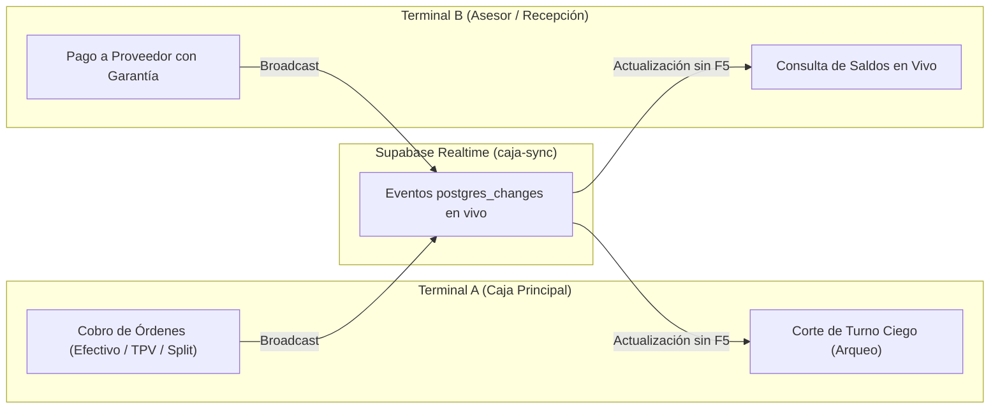
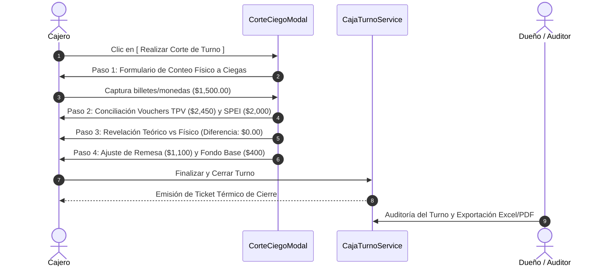

# Guión Maestro de Pruebas Funcionales: Punto de Venta (POS), Cortes de Caja y Reportes Contables

> **Sistema:** Cova (Plataforma Operativa de Taller Automotriz)  
> **Módulo:** `/caja` (Punto de Venta, Arqueos, Caja Chica, Comisiones y Auditoría)  
> **Objetivo:** Ejecutar la batería de pruebas de aceptación técnica y funcional de extremo a extremo, validando la estabilidad operativa individual, la sincronización concurrente multi-terminal en tiempo real y la precisión de los reportes antes de la demostración con el cliente.

---

## 1. Ficha Técnica y Entorno de Prueba

### 1.1 Configuración de Doble Terminal (Simulación Multi-Caja)
Para simular el flujo real del taller (donde el recepcionista y el cajero pueden tener la pantalla abierta simultáneamente):
- **Terminal A (Mostrador / Caja Principal):** Navegador habitual (ej. Google Chrome) con sesión activa en la sucursal de pruebas.
- **Terminal B (Asesor / Recepción):** Ventana de incógnito o navegador alterno (ej. Microsoft Edge / Firefox) autenticado en la **misma sucursal**.
- **Distribución en pantalla:** Colocar ambas ventanas en paralelo (pantalla dividida 50/50).

---

## 2. Matriz de Datos de Prueba (Valores Controlados)

Para que el corte de caja final cuadre con exactitud matemática a `$0.00` de descuadre, utilizaremos los siguientes valores predefinidos:

* **Fondo Inicial 1 (Operativo / Caja):** `$400.00`
* **Fondo Inicial 2 (Reserva / Fuerte):** `$8,500.00`
* **Ingresos (Cobros POS):**
  - Orden 1 (Efectivo Total): `$1,200.00`
  - Orden 2 (Terminal TPV): `$2,450.00`
  - Orden 3 (Pago Mixto / Split): `$3,000.00` (`$1,000.00` en Efectivo + `$2,000.00` en SPEI)
* **Egresos (Caja Chica):**
  - Gasto Operativo Menor: `$250.00` (Efectivo)
  - Pago a Proveedor (Amortiguador con garantía): `$850.00` (Efectivo)
* **Balance Teórico Esperado en Efectivo (Fondo 1):**
  $$\text{Saldo Final} = 400 + 1,200 + 1,000 - 250 - 850 = \$1,500.00$$
* **Remesa Sugerida (Retiro para caja fuerte / dueño):** `$1,100.00`
* **Fondo Base para el Siguiente Turno:** `$400.00`

---

## 3. Bloque 1: Apertura de Turno y Control de Fondos Iniciales

| ID | Acción | Datos a Ingresar | Resultado Esperado | Criterio de Aceptación |
| :--- | :--- | :--- | :--- | :--- |
| **TC-1.1** | Ingresar a `/caja` sin turno activo en **Terminal A**. | Ninguno. | La barra superior (`TurnoStatusBar`) muestra estado *"Sin Turno Abierto"* y deshabilita los cobros directos. | Previene cobros huérfanos sin cajero responsable asignado. |
| **TC-1.2** | Clic en **[ Abrir Turno ]** en Terminal A. | Despliegue del modal `AbrirTurnoModal`. | Muestra los campos para **Fondo 1 (Operativo)** y **Fondo 2 (Reserva)**. | Carga saldos sugeridos del turno anterior o valores por defecto. |
| **TC-1.3** | Confirmar apertura con fondos de prueba. | **Fondo 1:** `$400.00` **Fondo 2:** `$8,500.00` | El turno se crea en `caja_turnos` con estatus `ABIERTO`. La barra muestra saldo disponible `$400.00`. | Notificación de apertura exitosa. |
| **TC-1.4** | **Verificación en Terminal B (Concurrencia).** | Mirar la pantalla de Terminal B sin recargar (sin F5). | En menos de 1 segundo, la barra superior de Terminal B se sincroniza automáticamente a *"Turno Abierto"* con el nombre del cajero. | Sincronización reactiva mediante WebSockets de Supabase. |

---

## 4. Bloque 2: Punto de Venta (POS) y Cobros de Mostrador

### Caso 2.1: Cobro Total en Efectivo con Cálculo de Cambio
| ID | Acción | Datos a Ingresar | Resultado Esperado | Criterio de Aceptación |
| :--- | :--- | :--- | :--- | :--- |
| **TC-2.1** | En **Terminal A**, seleccionar Orden #1 en la lista lateral. | Saldo pendiente: `$1,200.00`. | Se cargan los datos del vehículo y cliente en el panel central de cobro. | Desglose claro de servicios/refacciones y saldo pendiente. |
| **TC-2.2** | Seleccionar método **Efectivo**. | Importe: `$1,200.00`. | Se activa el calculador de denominaciones y botones rápidos de efectivo. | Importe bloqueado al saldo exacto salvo abono parcial. |
| **TC-2.3** | Ingresar efectivo recibido mayor al total. | Ingresar: `$1,500.00` (o clic en `$1,000` + `$500`). | El sistema calcula en vivo: **Cambio a Entregar: `$300.00`** (en verde). | Evita errores de cálculo mental del cajero. |
| **TC-2.4** | Clic en **[ Cobrar e Imprimir Ticket ]**. | — | 1. Se registra el pago en `pagos_orden`. 2. Se abre el `ReceiptModal` con formato de ticket térmico. 3. El saldo de la orden pasa a `$0.00`. | Ticket listo para impresora térmica de 80mm/58mm. |
| **TC-2.5** | **Verificación en Terminal B (Concurrencia).** | Observar Orden #1 en Terminal B. | La orden cambia automáticamente a etiqueta verde *"Pagada"* con saldo `$0.00`. Si el usuario intenta cobrarla, el botón está inhabilitado. | Blindaje contra cobros duplicados entre dos mostradores. |

---

### Caso 2.2: Cobro con Tarjeta / Terminal TPV (Lote y Comisiones)
| ID | Acción | Datos a Ingresar | Resultado Esperado | Criterio de Aceptación |
| :--- | :--- | :--- | :--- | :--- |
| **TC-2.6** | En **Terminal A**, seleccionar Orden #2. | Saldo pendiente: `$2,450.00`. | Se despliega la orden para cobro bancario. | Correcta visualización de totales. |
| **TC-2.7** | Cambiar a pestaña **TPV / Tarjeta**. | • **Terminal:** Seleccionar *Point Smart* (o TPV disponible). • **Folio/Voucher:** `AUTH-88231`. | Se activan los campos de conciliación de voucher bancario. | Registra la trazabilidad contable de la pasarela. |
| **TC-2.8** | Clic en **[ Cobrar ]**. | — | Se registra el pago como método electrónico. El dinero entra a bancos/lote de terminal sin alterar el efectivo físico de gaveta. | No debe inflar el saldo de billetes del cajero. |

---

### Caso 2.3: Cobro Dividido / Mixto (Split Payment)
| ID | Acción | Datos a Ingresar | Resultado Esperado | Criterio de Aceptación |
| :--- | :--- | :--- | :--- | :--- |
| **TC-2.9** | En **Terminal A**, seleccionar Orden #3. | Saldo pendiente: `$3,000.00`. | Despliegue de orden de alto valor. | Panel listo para configuración de cobro múltiple. |
| **TC-2.10** | Seleccionar método **Split / Dividido**. | — | Se activa el componente `SplitPaymentManager`. | Permite agregar múltiples métodos de pago a la misma orden. |
| **TC-2.11** | Configurar los dos métodos: | **Método 1:** `Efectivo` • Monto: `$1,000.00` • Recibido: `$1,000.00`  Clic en **[ + Agregar Método ]**  **Método 2:** `SPEI / Transferencia` • Monto: `$2,000.00` • Ref: `TR-44910`. | El indicador dinámico muestra: **Total Asignado: `$3,000.00` / Restante: `$0.00`** (en color esmeralda). | Valida que la suma de métodos cubra el 100% del total antes de permitir guardar. |
| **TC-2.12** | Clic en **[ Confirmar Pago Dividido ]**. | — | El sistema procesa atómicamente a través de `MultiPaymentService.registrarPagosOrdenMulti`. Emite ticket con el desglose de ambos métodos. | Efectivo suma a gaveta; SPEI suma a cuenta bancaria. |

---

## 5. Bloque 3: Caja Chica y Pagos a Proveedores con Garantía

| ID | Acción | Datos a Ingresar | Resultado Esperado | Criterio de Aceptación |
| :--- | :--- | :--- | :--- | :--- |
| **TC-3.1** | En **Terminal B**, cambiar a pestaña **Caja Chica** y dar clic en **[ Registrar Movimiento ]**. | — | Se abre el modal de movimientos de caja chica. | Permite registrar egresos operativos del taller. |
| **TC-3.2** | Registrar un gasto de operación general. | • **Tipo:** *Egreso / Gasto Operativo* • **Concepto:** Compra de garrafones y papelería. • **Monto:** `$250.00` • **Método:** Efectivo. | Se descuenta del Fondo 1 (Operativo). Saldo en pantalla baja de `$2,600.00` a `$2,350.00`. | Actualización inmediata de saldo. |
| **TC-3.3** | En **Terminal B**, registrar compra de refacción urgente con garantía. | • **Tipo:** *Pago Proveedor* • **Proveedor:** Seleccionar proveedor de la lista. • **Concepto:** 1 Amortiguador Delantero Sentra. • **Monto:** `$850.00` • **Folio Ticket/Nota:** `FAC-7712` • **Garantía:** `12 meses` • **Archivo:** Subir imagen (JPG/PNG) o documento PDF de prueba. | 1. Se registra la salida de `$850.00`. 2. Se guarda la compra en `compras_proveedores`. 3. El archivo se sube a Supabase Storage (`proveedores-evidencias`). 4. Aparece la píldora discreta **`Ticket #FAC-7712`**. | Vinculación estricta de la garantía con el egreso monetario. |
| **TC-3.4** | **Verificación en Terminal A (Concurrencia).** | Mirar la pestaña Caja Chica en Terminal A sin refrescar. | Aparece la fila recién creada por Terminal B y el saldo del fondo se actualiza automáticamente a **`$1,500.00`**. | Sincronización en tiempo real de egresos entre terminales. |
| **TC-3.5** | Abrir comprobante desde Terminal A. | Clic sobre la píldora **`Ticket #FAC-7712`**. | Se abre el **Lightbox de Evidencia**, visualizando la foto en pantalla completa o el visor de PDF con zoom y botón de descarga. | Acceso inmediato a la póliza en caso de devolución de pieza. |

---

## 6. Bloque 4: Corte de Turno (Arqueo Ciego en 4 Pasos)

> **Regla de oro de negocio:** El cajero debe contar físicamente el dinero en su gaveta sin ver el saldo teórico que la computadora calcula, evitando manipulaciones o encubrimiento de diferencias.

| ID | Paso | Acción | Datos a Ingresar | Resultado Esperado |
| :--- | :--- | :--- | :--- | :--- |
| **TC-4.1** | **Paso 1: Conteo Físico Ciego** | En **Terminal A**, clic en **[ Realizar Corte de Turno ]**. | Desglose por denominaciones: | El acumulador calcula automáticamente **`$1,500.00`** en tiempo real. |
| | | | • Billetes de `$500`: `2` (`$1,000.00`) | |
| | | | • Billetes de `$200`: `2` (`$400.00`) | |
| | | | • Billetes de `$100`: `1` (`$100.00`) | |
| | | | • *Fondo 2 Declarado:* `$8,500.00` | |
| **TC-4.2** | **Paso 2: Conciliación Electrónica** | Clic en **[ Continuar a Bancos / TPV ]**. | Revisar totales calculados: | Valida los comprobantes físicos/vouchers de tarjetas contra lo ingresado en sistema. |
| | | | • Total TPV / Tarjetas: `$2,450.00` | |
| | | | • Total Transferencias SPEI: `$2,000.00` | |
| **TC-4.3** | **Paso 3: Revelación Teórico vs Declarado** | Clic en **[ Continuar a Comparativa ]**. | Comparativa del sistema: | Muestra estatus **Cuadrado Exacto** (en verde). Si hubiera descuadre, activa obligatoriamente el campo *"Justificación de Descuadre"*. |
| | | | • Teórico Fondo 1: `$1,500.00` | |
| | | | • Declarado Fondo 1: `$1,500.00` | |
| | | | • **Diferencia:** **`$0.00`** | |
| **TC-4.4** | **Paso 4: Remesa y Próximo Turno** | Clic en **[ Continuar a Remesa ]**. | • **Fondo Siguiente Turno:** `$400.00` • **Remesa a Caja Fuerte:** `$1,100.00` | El sistema sugiere la remesa exacta para dejar la caja lista para el siguiente turno. |
| **TC-4.5** | **Cierre Definitivo** | Clic en **[ Finalizar y Cerrar Turno ]**. | — | El turno se marca como `CERRADO` en base de datos. Se abre de inmediato el `TicketCierreModal`. |

---

## 7. Bloque 5: Reportes Contables y Auditoría del Día

| ID | Acción | Ubicación | Resultado Esperado | Criterio de Aceptación |
| :--- | :--- | :--- | :--- | :--- |
| **TC-5.1** | **Inspección del Ticket de Cierre.** | `TicketCierreModal` al finalizar el corte. | Muestra el desglose ejecutivo: fecha, cajero, ventas totales, desglose por forma de pago, egresos, saldo contado y remesa retirada. | Botón para imprimir ticket térmico o descargar en PDF. |
| **TC-5.2** | **Acceso a Auditoría Integral del Turno.** | Clic en **[ Ver Auditoría de Corte ]**. | Se abre el modal `CorteDiarioAuditoriaModal`. | Despliega pestañas de desglose: *Resumen, Bancos, Tarjetas, Proveedores, KPIs*. |
| **TC-5.3** | **Revisión de Pestañas de Conciliación.** | Pestañas del modal: | • **Resumen:** Conciliación global del turno. • **Bancos:** Lista de transferencias con claves de rastreo. • **Tarjetas:** Lotes de terminal y comisiones descontadas. • **Proveedores:** Compras y enlaces directos a sus pólizas. • **KPIs:** Margen estimado y ticket promedio. | Cuadre exacto con las transacciones efectuadas. |
| **TC-5.4** | **Exportación a Hoja de Cálculo (Excel).** | Clic en **[ Exportar Excel (.xlsx) ]**. | Descarga automática del archivo `.xlsx` estructurado con hojas contables detalladas. | Sin celdas truncadas, con formato de moneda estándar. |
| **TC-5.5** | **Generación de Reporte Impreso / PDF.** | Clic en **[ Imprimir / Guardar PDF ]**. | Se abre el cuadro de diálogo de impresión con CSS `@media print` optimizado para hoja tamaño carta. | Encabezado institucional, tablas legibles y sin cortes de página indeseados. |
| **TC-5.6** | **Sellado de Auditoría.** | Clic en **[ Marcar como Auditado ]**. | El turno pasa al estado `AUDITADO` con marca de tiempo. Se bloquea cualquier ajuste o recálculo posterior. | Integridad contable y prevención de fraudes retroactivos. |

---

## 8. Checklist de Validación para el Cliente (Go / No-Go)

Antes de concluir la sesión con el cliente, asegúrate de haber obtenido respuesta afirmativa en los siguientes puntos clave:

- [ ] **Cobros fluidos:** ¿El cajero pudo cobrar en efectivo con cálculo de cambio, tarjeta con folio de voucher y pago dividido en menos de 30 segundos por orden?
- [ ] **Cero doble cobro en mostrador:** ¿Al cobrar en una pantalla, la otra se actualizó inmediatamente sin necesidad de recargar?
- [ ] **Garantías protegidas:** ¿El pago al repartidor de refacciones incluyó la foto de la nota y los meses de garantía visibles para reclamos?
- [ ] **Arqueo ciego transparente:** ¿El cajero contó las monedas y billetes sin ver el teórico del sistema, y la comparación demostró control total?
- [ ] **Reportes contables listos:** ¿El dueño pudo consultar el resumen, exportar el archivo Excel y generar el PDF de auditoría con un solo clic?
